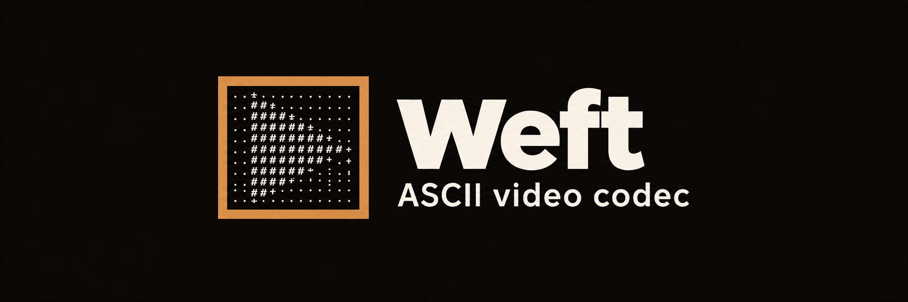
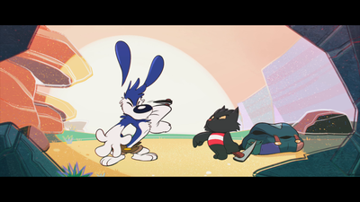

<p align="center">
  <a href="https://github.com/ecnivslabs/weft/stargazers"></a>
  <a href="https://github.com/ecnivslabs/weft/issues"></a>
  <a href="LICENSE"></a>
  
</p>

Weft is a Rust video codec built around ASCII symbols. The encoder fits source frames into colored glyph compositions, stores them in a seekable `.sci` archive, and the decoder reconstructs the picture from those compositions. Opus audio lives in the same archive.

Use the CLI to prepare video, the Rust library to work with frames and archives, or the WebAssembly decoder to build browser playback. Video timing, seek points and synchronized sound live in one file.

<table width="100%" align="center">
  <thead><tr><th width="600">Output</th><th width="400">Details</th></tr></thead>
  <tbody>
    <tr><td><a href="docs/assets/source-1080.png"></a></td><td><strong>Source</strong><br>1920×1080</td></tr>
    <tr><td><a href="docs/assets/weft-1080.png"></a></td><td><strong>Weft</strong><br>1080p</td></tr>
  </tbody>
</table>

## What is here

- **ASCII encoder and decoder.** Fixed printable glyphs, RGB attributes, reflections and layered spatial groups. Every rendered frame comes from that representation.
- **`.sci` archives.** Explicit presentation times, independent seek chunks, checksums, prepared renditions and synchronized audio.
- **Rust libraries and CLI.** The portable codec works without FFmpeg or a web server. Media ingestion is a separate crate.
- **Browser playback.** The same Rust decoder runs in workers through WebAssembly, with Canvas or equivalent WebGL2 glyph reconstruction.

Rendered resolution targets are 360p, 480p, 720p and 1080p. Ingestion preserves source timing up to 60 FPS. The local SCI player supports seeking, quality selection, playback speed and synchronized audio.

## Start here

Install Rust 1.89 or newer. Encoding also needs FFmpeg and FFprobe on `PATH`, with libopus support.

```sh
cargo build --release --locked
cargo run -p weft-cli --release -- encode videos/input.mp4 videos/output.sci
cargo run -p weft-cli --release -- inspect videos/output.sci
cargo run -p weft-cli --release -- decode videos/output.sci 30 frame.ppm
```

`decode` writes an RGB PPM reconstructed from a zero-based presentation frame. Existing output archives are never overwritten. [Encoding options](docs/encoding.md) cover resolution selection, timing and fitting options.

To build the website (Node.js 22 or newer):

```sh
npm ci --prefix website
npm run build:site --prefix website
```

`website/dist/` is the GitHub Pages artifact for `weft.ecnivs.com`. It contains the product website, image previews and hosted documentation. The SCI decoder stays with the native browser player. Original footage stays in the ignored `videos/` directory. Deployment uses a manually triggered [workflow](.github/workflows/deploy-website.yml). [Website development](docs/website.md) covers local preview and hosting.

## Documentation

- [Introduction](docs/introduction.md): the representation and project goals.
- [Encoding](docs/encoding.md): source preparation and CLI options.
- [Integration](docs/integration.md): using the Rust codec and archive reader.
- [Architecture](docs/architecture.md): ingestion, decoding and playback boundaries.
- [Website](docs/website.md): static build, local server and GitHub Pages.
- [Benchmarks](docs/benchmarking.md): reproducible comparisons and validation.
- [SCI specification](formats/SCI.md): the binary format and reconstruction rules.
- [Full index](docs/index.md).

## Research

Weft’s longer-term goal is faithful video with lower bandwidth and playback cost. Recorded comparisons favor the tested conventional codecs in archive size, and fitting remains lossy. Sustained 2x playback across every resolution is not yet established. [Research status](docs/research.md) separates implemented features from measured results and future targets.

## Contributing

Fork, make a focused change, and open a pull request against `master`. Codec changes need format and decoder agreement tests. Performance changes need controlled measurements. Read [CONTRIBUTING.md](CONTRIBUTING.md) before starting.

## License

[Weft Noncommercial License 1.0](LICENSE). Noncommercial use is free. Commercial use requires a separate paid license from the applicable copyright holders, including use by solo developers.

Media and fonts have separate terms. See [asset notices](website/ASSETS.md) and the notices under [website/web/fonts](website/web/fonts).
